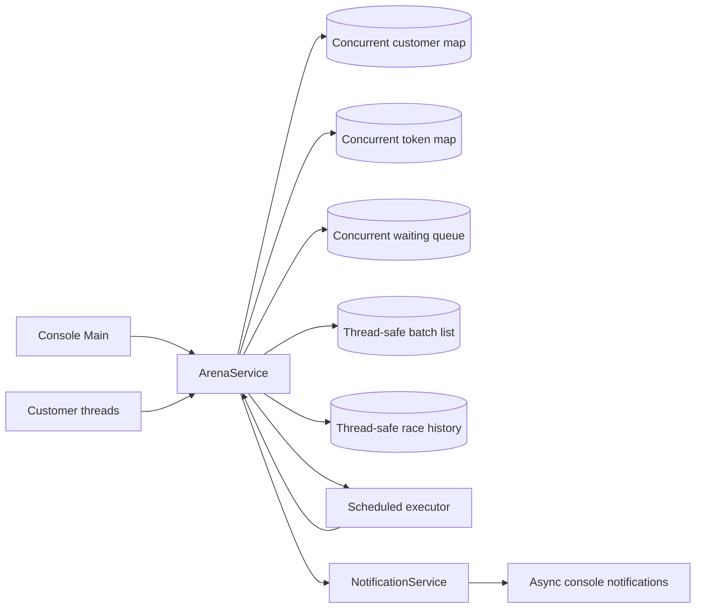
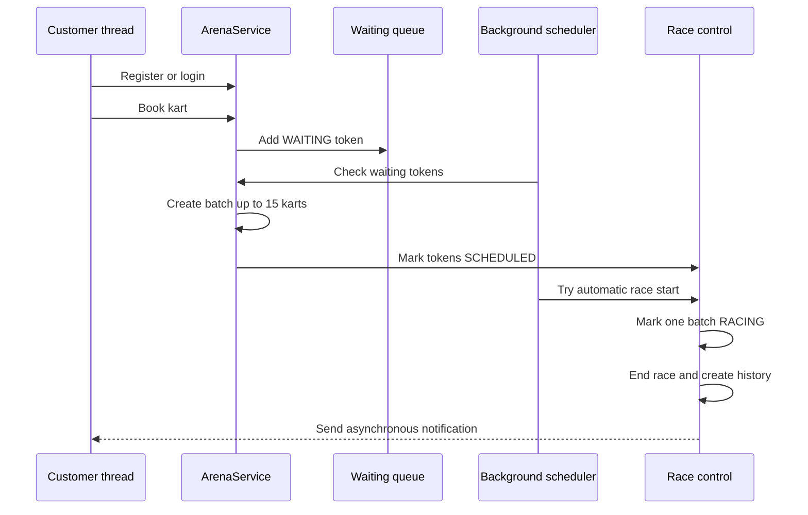

# FNF Karting Arena

> A beginner-friendly Java console application that grows from a simple
> karting booking system into a thread-safe, real-time race scheduler.

## Project status

The repository contains two isolated applications:

```text
karting-race-scheduler/
├── phase-1/       # Original single-threaded booking application
├── phase-2/       # Final multithreaded application
├── README.md      # Master project documentation
└── .gitignore
```

Phase 2 is the final working output. It keeps the Phase 1 booking rules and
adds concurrent bookings, background scheduling, token expiry, race locking,
automatic race starts, and asynchronous notifications. The two applications
have separate source folders and can be compiled independently.

## Quick start

### Phase 2 - final application

Run these commands from the repository root in PowerShell:

```powershell
Remove-Item phase-2\out -Recurse -Force -ErrorAction SilentlyContinue
New-Item -ItemType Directory -Force phase-2\out

javac -d phase-2\out (Get-ChildItem -Recurse -Filter *.java phase-2\src | ForEach-Object FullName)
java -cp phase-2\out console.Main
```

Admin login:

```text
Username: admin
Password: admin
```

The application starts with customer registration, customer login, and admin
login. The admin panel contains the developer tools used to demonstrate the
multithreaded features.

### Run the Phase 2 test

```powershell
javac -cp phase-2\out -d phase-2\out (Get-ChildItem -Recurse -Filter *.java phase-2\test | ForEach-Object FullName)
java -cp phase-2\out ConcurrencyTest
```

### Run Phase 1

```powershell
Remove-Item phase-1\out -Recurse -Force -ErrorAction SilentlyContinue
New-Item -ItemType Directory -Force phase-1\out

javac -d phase-1\out (Get-ChildItem -Recurse -Filter *.java phase-1\src | ForEach-Object FullName)
java -cp phase-1\out console.Main
```

## Phase 1 and Phase 2

### Phase 1: the baseline

Phase 1 provides the original arena behavior:

- Customer registration and login
- Customer bookings
- Kart and lap validation
- Waiting tokens
- Race batch creation
- Manual race start and end
- Booking cancellation and reprioritization
- Race history and revenue

It uses normal Java collections and a single console flow. It is preserved as
the reference application and is not changed by Phase 2.

### Phase 2: the final expansion

Phase 2 keeps the same domain ideas but allows several activities to happen at
the same time:

| Area | Phase 2 behavior |
|---|---|
| Concurrent booking | Five or more customer threads can book together |
| Shared maps and queues | Concurrent collections protect shared booking data |
| Batch scheduler | A background task assigns waiting tokens to batches |
| Token expiry | A watcher expires old tokens left in `WAITING` |
| Automatic race start | A scheduled task attempts to start a batch every 30 seconds |
| Race control | Only one race can be active at a time |
| Track capacity | Maximum 15 karts is tracked safely |
| Admin controls | Admin actions can run while background work is active |
| Notifications | Race events are printed by notification threads |
| Verification | Concurrency, cancellation, overlap, expiry, history, and revenue are tested |

## Phase 2 architecture



### Main code areas

| Location | Responsibility |
|---|---|
| `phase-2/src/console/Main.java` | Customer, admin, and developer menus |
| `phase-2/src/services/ArenaService.java` | Booking, scheduling, race control, expiry, and revenue |
| `phase-2/src/services/NotificationService.java` | Asynchronous event messages |
| `phase-2/src/models/` | Customers, tokens, batches, and race history |
| `phase-2/src/enums/` | Kart, token, and batch states |
| `phase-2/src/exceptions/` | Clear errors for invalid operations |
| `phase-2/test/ConcurrencyTest.java` | Executable concurrency and consistency checks |

## Thread-safety design

| Shared value | Java solution | Why it is used |
|---|---|---|
| Customers and tokens | `ConcurrentHashMap` | Safe lookup and updates from several threads |
| Waiting bookings | `ConcurrentLinkedQueue` | Safe first-in, first-out booking queue |
| Customer bookings | `CopyOnWriteArrayList` | Safe reads while bookings are being added |
| Batch tokens | `CopyOnWriteArrayList` | Safe batch viewing during live operations |
| Token and batch numbers | `AtomicInteger` | Prevents duplicate IDs |
| Active race | `AtomicReference<RaceBatch>` | Ensures only one active race |
| Karts in use | `AtomicInteger` | Safe live capacity counter |
| Batch assignment | `ReentrantLock` | Keeps queue-to-batch assignment together |
| Registration and race updates | `synchronized` methods | Protects multi-step state changes |
| Token status | `volatile` field | Makes status changes visible to other threads |

## Runtime workflow



### Token lifecycle

```text
WAITING
   ├── scheduler assigns batch ──> SCHEDULED ──> RACING ──> COMPLETED
   ├── customer/admin cancellation ────────────> CANCELLED
   └── expiry watcher ─────────────────────────> EXPIRED
```

### Background jobs

When the admin enables the background scheduler:

1. The batch task checks the waiting queue every second.
2. The expiry task checks old waiting tokens every second.
3. The auto-start task checks for a scheduled race every 30 seconds.
4. Race start and end events send asynchronous notifications.
5. Calling `shutdown()` stops the executor when the application exits.

The default token expiry period is five minutes. The test constructor uses
shorter values so expiry can be verified without waiting five minutes.

## Developer and admin tools

Open the application with the admin login and choose **DEV / ADMIN Test
Tools**:

```text
1. Simulate Multiple Concurrent Bookings
2. Start Background Scheduler Thread
3. Auto-Start Race Every 30 Seconds
4. Enable Token Expiry Timer (5 min)
5. Simulate Admin Cancelling During Batch Assignment
6. View Live Race Log
7. Back to Admin Menu
```

These are demonstration controls, so the timing can be observed directly in
the console while the application is running.

## Testing coverage

`ConcurrencyTest` checks:

- Five customers can book from separate threads.
- The expected number of waiting tokens is created.
- A token can be cancelled while the scheduler is active.
- A scheduled race starts successfully.
- A second race cannot start while another race is active.
- Ending a race creates history and revenue.
- A waiting token expires when its expiry time is reached.
- Background executors are shut down cleanly.

## Build and troubleshooting

If old compiled files cause confusing results, remove the output directory and
compile again:

```powershell
Remove-Item phase-2\out -Recurse -Force -ErrorAction SilentlyContinue
New-Item -ItemType Directory -Force phase-2\out
```

If Java is not found, install a JDK and confirm the tools are available:

```powershell
java -version
javac -version
```

Phase 1 and Phase 2 have separate output directories. Compile only the phase
you want to run.

## Collaboration and Git workflow

The stable branch is `main`. Work should be developed on personal branches and
merged through Pull Requests:

```text
main
├── hemanth
└── payal
```

Typical workflow:

```powershell
git switch main
git pull origin main
git switch -c your-name

# Make and test changes
git add phase-2
git commit -m "Describe the Phase 2 change clearly"
git push -u origin your-name
```

Create a Pull Request from `your-name` into `main`. The reviewer checks the
changed files, runs the build and tests, and merges only after the behavior is
understood and verified. After a merge, update local `main` before starting
new work:

```powershell
git switch main
git pull origin main
```

`origin` is simply the Git name for the GitHub repository. It is not part of
the branch name.

## Final deliverable

The final deliverable is the Phase 2 application under `phase-2/`. It is a
standalone Java console application that demonstrates how the original
single-threaded arena can safely support concurrent customers, scheduled
operations, live race control, and consistent race history and revenue.
